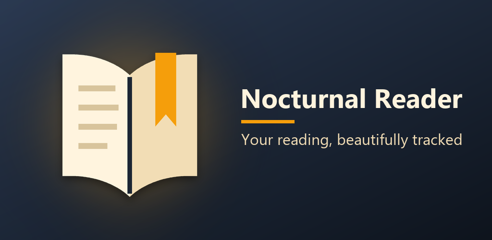

# Nocturnal Reader 📚

An elegant, privacy-first, zero-dependency local Android app for power readers.



## Features 🚀

- **Local-First Architecture:** No accounts, no cloud sync, no tracking. Your data belongs to you and lives locally in a Room database.
- **Interactive Reading Journey Map:** A beautifully animated `Canvas` timeline of every book you've finished, complete with milestone markers!
- **Animated Wrapped Export (GIF):** Generate a buttery-smooth Animated GIF of your reading year directly on-device using our native zero-dependency encoder. Share it straight to Instagram or Twitter!
- **Advanced Markdown Export:** Seamlessly sync your margin notes, highlights, and book library to Obsidian or Notion with a single tap.
- **GitHub-Style Reading Heatmap:** Visualize your reading consistency and daily page-count over time.
- **Native Compose EPUB Engine:** Read EPUBs effortlessly with our fully-native Jetpack Compose parsing engine.
- **Focus Timer & Wear OS Sync:** Deep focus sessions with an integrated pomodoro timer, seamlessly bridged to your Wear OS smartwatch.
- **ML Kit Scanning:** Add books to your library via Barcode or ISBN text recognition.

## Architecture & Tech Stack 🛠️

- **100% Kotlin & Jetpack Compose**
- **Room Database** (Local storage)
- **CameraX & ML Kit** (Barcode scanning)
- **Wear OS Data Layer API** (Watch sync)
- **Zero Heavy Dependencies** (No bloated third-party libraries for GIF generation or EPUB parsing)

## Building 🔧

Requires JDK 17+ and the Android SDK (compile SDK 36).

```bash
./gradlew assembleDebug        # debug build
./gradlew :app:bundleRelease   # Play Store bundle — see RELEASE.md first
```

Publishing (app ID, signing key, privacy policy, Play Console answers) is
documented step by step in [RELEASE.md](RELEASE.md).

## Contributing 🤝

Pull requests are welcome. For major changes, please open an issue first to discuss what you would like to change.

## License 📄

[MIT](https://choosealicense.com/licenses/mit/)
